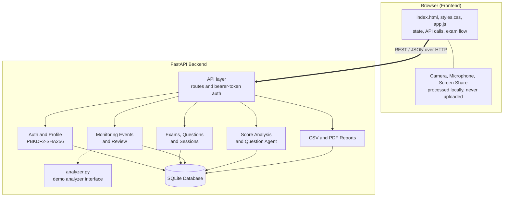
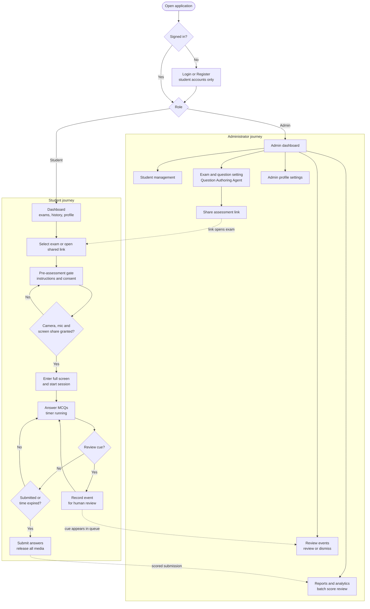
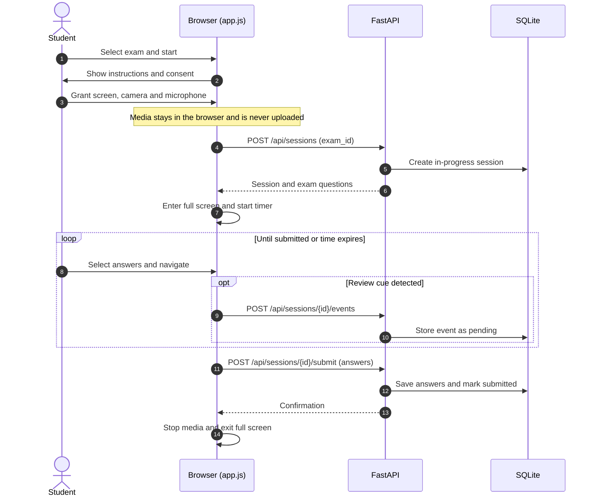
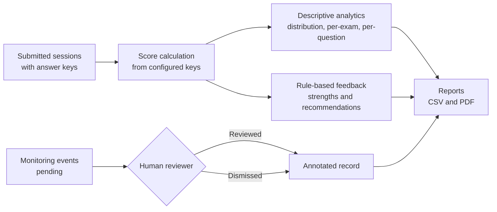

# ExamGuard AI

**An online exam monitoring prototype with a responsive web frontend, FastAPI backend and SQLite persistence.**


ExamGuard AI is a full-stack, runnable educational prototype. Students take timed multiple-choice exams in a focused, permission-gated environment. Administrators manage students, exams and question banks, review monitoring cues, and analyse results.

> [!IMPORTANT]
> **AI limitation.** This prototype does **not** include a trained CNN/LSTM model.
> Monitoring events produced by the demo button are **simulated** and clearly labelled.
> They are not model predictions and **not proof of cheating**. Raw camera, microphone and
> screen content is **never recorded or uploaded**; the browser keeps it local.

---

## Table of Contents

1. [Features](#features)
2. [System Flow](#system-flow)
3. [Tech Stack](#tech-stack)
4. [Project Structure](#project-structure)
5. [Getting Started](#getting-started)
6. [Demo Accounts](#demo-accounts)
7. [API Overview](#api-overview)
8. [Administrator Workspace](#administrator-workspace)
9. [Security](#security)
10. [Known Limitations](#known-limitations)
11. [Future Deep Learning Integration](#future-deep-learning-integration)
12. [Development Notes](#development-notes)

---

## Features

### Student

- Public registration (student role only) with password confirmation
- Sign in, forgot-password flow (local-demo reset token) and profile settings
- Dashboard with available exams and session history
- Pre-assessment permission gate: consent plus camera, microphone and screen-sharing access
- Focused full-screen exam mode with timer, question navigator and auto-submit on timeout
- Review cues recorded for events such as leaving full screen

### Administrator

- **Student management:** search students, activate or deactivate accounts (deactivation revokes active tokens)
- **Exam and question setting:** create, edit and delete exams; add, edit and delete MCQs with answer keys
- **Question Authoring Agent:** offline, template-based MCQ drafts by topic, difficulty and count
- **Review events:** annotate, mark as reviewed or dismiss monitoring cues
- **Reports and analytics:** score distribution, per-exam average, highest and lowest scores, question-level correct rates
- **Batch score review:** score all submitted exams in one run, with transparent rule-based feedback
- **Exports:** event reports (CSV and PDF) and reviewed-score reports (CSV and PDF)
- **Share assessment:** generate an assessment link and share it via copy link, WhatsApp, Gmail or Telegram
- **Admin profile settings:** change display name, login email and password

### Platform

- SQLite database created automatically on first run
- PBKDF2-SHA256 password hashing, with legacy demo passwords upgraded on first successful login
- Interactive API documentation at `/docs`

---

## System Flow

### 1. Architecture



### 2. End-to-End User Flow



### 3. Exam Session Sequence



### 4. Admin Review and Scoring Flow



---

## Tech Stack

| Layer      | Technology                                             |
| ---------- | ------------------------------------------------------ |
| Frontend   | HTML, CSS, vanilla JavaScript                          |
| Backend    | Python, FastAPI, Uvicorn                               |
| Database   | SQLite                                                 |
| Auth       | Bearer tokens, PBKDF2-SHA256 password hashing          |
| Browser    | `getUserMedia`, `getDisplayMedia`, Fullscreen API      |
| Reports    | CSV and PDF generation from the backend                |

---

## Project Structure

```text
ExamGuard-AI/
├── backend/
│   ├── __init__.py
│   ├── main.py          # FastAPI routes, auth, SQLite persistence
│   └── analyzer.py      # Demo analyzer interface for future DL integration
├── frontend/
│   ├── index.html       # Pages and layout
│   ├── styles.css       # Responsive UI
│   └── app.js           # Frontend state, API calls, exam flow, media permissions
├── requirements.txt
├── .env.example
└── README.md
```

---

## Getting Started

### Prerequisites

- Python 3.x with `pip`
- A modern desktop browser (Chrome, Edge or Firefox) with camera, microphone and screen-sharing support
- HTTPS or `localhost` (required by browsers for media capture)

### Run on Windows (PowerShell)

```powershell
cd <path-to-project>
py -m venv .venv
.\.venv\Scripts\Activate.ps1
pip install -r requirements.txt
uvicorn backend.main:app --reload
```

### Run on macOS / Linux

```bash
cd <path-to-project>
python3 -m venv .venv
source .venv/bin/activate
pip install -r requirements.txt
uvicorn backend.main:app --reload
```

Then open **<http://127.0.0.1:8000>**. Interactive API docs are at **<http://127.0.0.1:8000/docs>**.

### Configuration

Copy `.env.example` to `.env` and adjust values as needed.

| Variable               | Purpose                                                                         |
| ---------------------- | ------------------------------------------------------------------------------- |
| `EXAMGUARD_DEMO_RESET` | Set to `0` to stop the API returning the demo password-reset token in responses |

---

## Demo Accounts

Seeded only when the database contains no users.

| Role    | Email                    | Password            |
| ------- | ------------------------ | ------------------- |
| Student | `student@examguard.local` | `StudentDemo123!`  |
| Admin   | `admin@examguard.local`   | `AdminDemo123!`    |

> [!WARNING]
> Change or remove these credentials before any shared or production deployment.

---

## API Overview

Endpoints used by the frontend. See `/docs` for the complete, interactive reference.

| Area            | Endpoints                                                                                       |
| --------------- | ----------------------------------------------------------------------------------------------- |
| Authentication  | `POST /api/auth/login`, `/register`, `/forgot-password`, `/reset-password`                      |
| Profile         | `GET /api/me`, `PUT /api/profile`                                                               |
| Exams (student) | `GET /api/exams`, `GET /api/sessions/mine`                                                      |
| Sessions        | `POST /api/sessions`, `POST /api/sessions/{id}/events`, `POST /api/sessions/{id}/submit`        |
| Admin: users    | `GET /api/admin/students`, `PATCH /api/admin/students/{id}/status`, `GET/PUT /api/admin/profile` |
| Admin: exams    | `POST/PUT/DELETE /api/admin/exams`, `GET /api/admin/exams/{id}/share-link`                      |
| Admin: questions| `GET/POST /api/admin/exams/{id}/questions`, `PUT/DELETE /api/admin/questions/{id}`              |
| Admin: agent    | `POST /api/admin/agents/question-drafts`                                                        |
| Admin: review   | `GET /api/admin/sessions`, `GET /api/admin/events`, `PATCH /api/admin/events/{id}`              |
| Analytics       | `GET /api/admin/analytics`, `/score-analysis`, `/score-analysis/batch-review`, `/sessions/{id}/analysis` |
| Reports         | `GET /api/reports/events.csv`, `events.pdf`, `score-review.csv`, `score-review.pdf`             |

---

## Administrator Workspace

| Page                         | What you can do                                                                                          |
| ---------------------------- | -------------------------------------------------------------------------------------------------------- |
| **Student management**       | Search students and activate or deactivate accounts. Deactivation revokes existing login tokens.         |
| **Exam and question setting**| Create or edit exam metadata, manage MCQs and answer keys, generate editable drafts, share assessments.  |
| **Review events**            | Annotate, review or dismiss monitoring cues. Cues are review aids, not proof of misconduct.              |
| **Reports and analytics**    | Overall average, score distribution, per-exam and question-level statistics, batch review, exports.      |
| **Admin profile settings**   | Change display name, login email and password.                                                           |

**Question Authoring Agent.** Open *Exam and question setting*, choose a topic, difficulty and number of drafts, then select a draft to populate the normal question form. Verify the options and answer key before saving. Drafts are never published automatically.

**Scoring.** Only submitted sessions with configured answer keys are included in scored aggregates. Score guidance is a transparent rule-based baseline.

---

## Security

- New accounts use **PBKDF2-SHA256** password hashes; legacy seeded demo passwords are upgraded on first successful login.
- Authentication is a lightweight educational **bearer-token** implementation.
- Deactivating a student revokes existing tokens.
- Changing the admin email or password signs out active administrator sessions.

Before any public deployment, add:

- HTTPS
- Rate limiting
- Token expiry and rotation
- Secure password-reset emails
- Audit logging
- CSRF review where applicable
- Secret management
- A formal security assessment

---

## Known Limitations

- **No trained model.** The analyzer is a demo interface and does not inspect webcam pixels. Monitoring events are simulated.
- **Not a predictor.** Score guidance is a rule-based baseline, not a validated or predictive AI model.
- **Question agent is offline.** It is template-based and does not call an external LLM. Review every draft and every low-correct-rate question before live use.
- **Limited screen monitoring.** The app can detect when screen sharing stops, but it cannot reliably read other browser tabs or inspect background websites.
- **Password reset is a demo.** No email provider is configured, so a local reset token is used.
- **No automatic penalties.** Never use monitoring cues alone to penalise a student; a human must review them.

---

## Future Deep Learning Integration

Replace the demo analyzer with a validated Python model or service using OpenCV, MediaPipe and, where appropriate, a temporal CNN-LSTM.

1. Collect and use **consented** data only.
2. Evaluate **false-positive rate and recall** before deployment.
3. Keep a **human in the loop** for every cue.
4. Do **not** automate penalties from model output.

---

## Development Notes

### Camera handling

The exam renderer replaces the exam container contents on every answer or navigation. To keep the camera stable:

- `frontend/app.js` keeps **one hidden video element outside the re-rendered container** and reuses the existing stream.
- Video is requested at **640x480, target 15 FPS (maximum 20 FPS)**.
- The camera image is not shown during the exam, and processing is not stopped just to hide the preview.

### Syntax check

```bash
node --check frontend/app.js
```

Camera, microphone, screen-sharing and full-screen behaviour still needs to be verified in the target browser.

---

## Disclaimer

ExamGuard AI is an educational prototype. Review authentication, rate limiting, CSRF protection, audit logging and secret management before any production deployment.